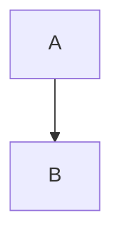

# Code blocks

The rendering of fenced code that the highlighter must keep.

```go
package main

import "fmt"

// main says hi
func main() {
	x := 42 // n
	fmt.Printf("%d\n", x)
}
```

```python
def f(x: int) -> str:
    """doc"""
    return f"{x}" if x > 0 else None  # c
```

```bash
#!/bin/sh
set -e
for f in *.md; do echo "$f" | grep -q x && exit 1; done
```

```sh
ls -la ~ > /dev/null 2>&1
```

```yaml
a: 1
b: [x, "y"]
# c
c:
  - true
```

```json
{"a": 1, "b": [true, null, "s"]}
```

```js
const f = async (a) => { await fetch(`/x/${a}`); return /re+/g.test(a) }
```

```ts
interface A { b?: number }
export function g<T>(x: T): T { return x }
```

```vue
<template><p :a="b">{{ c }}</p></template>
```

```html
<!doctype html>
<div class="x" id=y>&amp; <b>t</b></div>
```

```css
.a > b:hover { color: #fff; margin: 0 1px !important }
```

```sql
SELECT a, count(*) FROM t WHERE b = 'x' GROUP BY a; -- c
```

```rust
fn main() { let v: Vec<u8> = vec![1]; println!("{:?}", v); }
```

```c
#include <stdio.h>
int main(void) { return printf("%d", 1); }
```

```java
public class A { @Override public String toString() { return "a"; } }
```

```diff
--- a
+++ b
@@ -1 +1 @@
-x
+y
```

```dockerfile
FROM alpine:3
RUN apk add --no-cache git
CMD ["sh"]
```

```toml
[a]
b = "c"
d = 1
```

```xml
<?xml version="1.0"?>
<a b="c"><!-- d --></a>
```

```markdown
# t

*a* `b` [[not a link]]
```

```Go
var x = 1
```

```text
plain text <b>
```



```view
from: p/notes
where:
  - status = open
```

```nosuchlang
whatever <script>alert(1)</script> & "q"
```

```
no language <i>
```

```go {linenos=true}
a := 1
b := 2
```

```go {linenos=table}
a := 1
b := 2
```

```go {linenos=inline, linenostart=5}
a := 1
b := 2
```

```go {hl_lines=[2,"3-4"]}
a := 1
b := 2
c := 3
d := 4
```

```go {linenos=true, linenostart=10, hl_lines=[11]}
a := 1
b := 2
```

```go {nohl}
a := 1 <b>
```

```go {style=monokai}
a := 1
```

```nosuchlang {linenos=true}
x
```

~~~python
print('tilde fence')
~~~

    indented code, not fenced

- a list item with code:

  ```go
  x := 1
  ```

> [!note] A callout
> ```go
> x := 1
> ```

````md
```go
nested fence
```
````

```go
```
